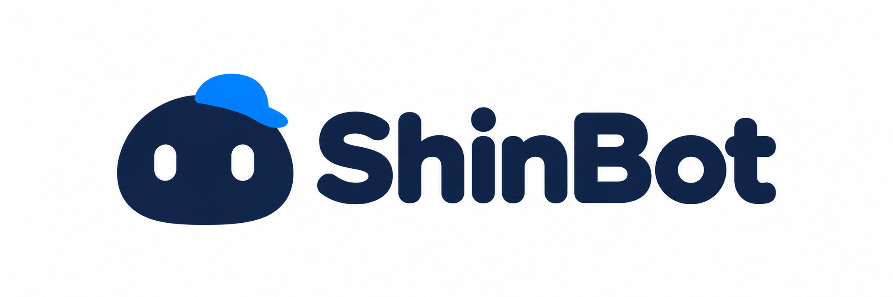

# ShinBot

<p></p>

ShinBot is a self-hosted personal assistant. Ask it to research a question, use a website, work with files, or run a scheduled task. Watch its browser, take control to sign in, and give different bots their own roles and browser profiles.

[Website](https://adarshdigievo.github.io/shinbot/) · [Documentation](https://adarshdigievo.github.io/shinbot/docs/) · [Releases](https://github.com/adarshdigievo/shinbot/releases)

ShinBot supports one owner with multiple bot profiles. Use a capable tool-calling model and review consequential actions. Handle email and calendar workflows through the browser or installed plugins.

## Get started

Use Linux or macOS, Python 3.13 or newer, [uv](https://docs.astral.sh/uv/) and a running Docker-compatible engine with Docker Compose.

```sh
uvx --prerelease allow shinbot start
```

ShinBot downloads its service images and opens **http://localhost:8765** with a one-time setup link. Choose a password, connect a model, and try a small task. Home includes starter templates and prompts.

For a persistent CLI installation:

```sh
uv tool install --prerelease allow shinbot
shinbot start
```

You can also use `python -m pip install --pre shinbot` in a virtual environment. The Python package is the launcher and CLI; Docker still runs the application services. On a headless host, use `shinbot start --no-open-browser` and retrieve the token with `shinbot setup-token`.

See the [installation guide](https://adarshdigievo.github.io/shinbot/docs/user-guide/installation.html), [model setup](https://adarshdigievo.github.io/shinbot/docs/user-guide/models.html) and [remote access guide](https://adarshdigievo.github.io/shinbot/docs/user-guide/remote-access.html).

## What you can do

| Capability | Learn more |
| --- | --- |
| Chat in a desktop-style web app or the CLI, with automatic context compaction and action approvals | [Conversations](https://adarshdigievo.github.io/shinbot/docs/user-guide/conversations.html) |
| Use a persistent browser, watch it work, take control and hand it back | [Computer](https://adarshdigievo.github.io/shinbot/docs/user-guide/browser-and-files.html) |
| Create bot profiles and groups, share templates, and choose private, group or shared browser logins | [Bots and templates](https://adarshdigievo.github.io/shinbot/docs/user-guide/bots-and-templates.html) |
| Keep editable notes and explicitly saved memories, with search and Markdown exports | [Notebook](https://adarshdigievo.github.io/shinbot/docs/user-guide/notes-and-memory.html) |
| Run one-time tasks and recurring routines | [Scheduled jobs](https://adarshdigievo.github.io/shinbot/docs/user-guide/scheduled-jobs.html) |
| Connect MCP, install plugins and skills, and review procedures learned from tested work | [Plugins](https://adarshdigievo.github.io/shinbot/docs/user-guide/plugins.html) |
| Choose model providers, supported subscription sign-ins or compatible local endpoints | [Models](https://adarshdigievo.github.io/shinbot/docs/user-guide/models.html) |

The app supports light, dark and system appearance. System is the default; your choice is saved in the browser.

## Your installation and data

The launcher saves configuration in `~/.shinbot`. Docker volumes hold conversations, notes, credentials, browser profiles, scheduled jobs and workspace files. Removing or reinstalling the Python package leaves that data in place. Keep the same OS account, launcher home and Docker engine when reinstalling.

```sh
shinbot status
shinbot doctor
shinbot stop
shinbot backup /safe/location/shinbot.tar.gz
```

Stopping preserves data. Backups contain credentials as well as your work; keep them private. Read [backup and recovery](https://adarshdigievo.github.io/shinbot/docs/user-guide/backups-and-upgrades.html) before moving an installation or deleting volumes.

The gateway binds to loopback by default. Remote access can use an SSH tunnel or an HTTPS reverse proxy. Internal services stay private. Model providers receive the context needed for model calls. Executable plugins have workspace and outbound network access, so install code from sources you trust.

## Built from six parts

| Part | Built with |
| --- | --- |
| Agent | Pi Durable, Pi AI and Chord in a small TypeScript service |
| Gateway | Python, FastAPI and plain HTML/CSS/JavaScript |
| Computer | Python worker, MCP, Playwright, Chromium, Xvfb, TigerVNC and noVNC |
| Notebook | SQLite FTS5 and Markdown exports |
| Jobs | Python coordinator, croniter and SQLite |
| Plugins | Versioned manifests, content hashes and separate processes |

Four services start by default. ShinBot uses published upstream packages through their public interfaces.

## Extend ShinBot

Add sidebar apps, themes, chat and tool hooks, MCP servers, skills or bot templates through plugins. The [extension guide](https://adarshdigievo.github.io/shinbot/docs/user-guide/extending.html) explains the options and how to build your own.

The optional [Projects plugin](https://adarshdigievo.github.io/shinbot/docs/user-guide/plugins.html#coding-projects-and-parallel-tasks) adds a GitHub attention inbox, issue-linked bot conversations and reminders, repository browsing, parallel worktrees and bot delegation. The optional Calendar plugin connects Google Calendar with read-only access and shows events alongside scheduled bot work. Manage encrypted integration and plugin credentials through Settings → Secrets. The [Kanban plugin](https://adarshdigievo.github.io/shinbot/docs/user-guide/plugins.html#kanban-board) adds a board for work that needs several runs.

The official Telegram plugin adds a private chat connection. Follow its [setup guide](https://adarshdigievo.github.io/shinbot/docs/user-guide/telegram.html) when you want to use it.

## Contribute

The official repositories are [shinbot-official-plugins](https://github.com/adarshdigievo/shinbot-official-plugins) and [shinbot-official-templates](https://github.com/adarshdigievo/shinbot-official-templates). Users can add public personal repositories in the same format. Starter catalogs are included under `marketplaces/`.

From a source checkout:

```sh
uv sync --frozen --extra computer
npm --prefix runtime ci --ignore-scripts
npm --prefix runtime run build
uv run --frozen shinbot start --build
```

Read the [architecture](https://adarshdigievo.github.io/shinbot/docs/developers/architecture.html), [development and tests](https://adarshdigievo.github.io/shinbot/docs/developers/development.html), [plugin guide](https://adarshdigievo.github.io/shinbot/docs/developers/plugins.html), and [template format](https://adarshdigievo.github.io/shinbot/docs/developers/templates.html).

GitHub Actions checks Python, the runtime, browser journeys, container integration, packaging and documentation. Publishing runs only for published GitHub Releases, which publish versioned Docker images, the Python package, the landing page and documentation from the release tag. The [release guide](https://adarshdigievo.github.io/shinbot/docs/developers/releases.html) covers trusted publishing, Docker credentials and GitHub Pages.

## Licenses

ShinBot is MIT-licensed. Application dependencies primarily use permissive licenses. Reviewed exceptions include noVNC and certifi under MPL-2.0, and the optional Telegram library under LGPL-3.0. Dependencies are distributed unchanged with their notices. Platform components, including Linux, Chromium and TigerVNC, have separate licenses. See the [license guide](https://adarshdigievo.github.io/shinbot/docs/reference/licenses.html) for the application, documentation and platform inventories.
