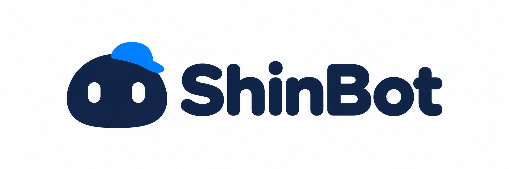

# ShinBot



A self-hosted personal assistant that browses the web, works with files, and runs scheduled tasks. Create bot profiles with their own roles and browser sessions, connect a model, and add plugins and skills.

[Website](https://adarshdigievo.github.io/shinbot/) · [Documentation](https://adarshdigievo.github.io/shinbot/docs/) · [Source](https://github.com/adarshdigievo/shinbot) · [Releases](https://github.com/adarshdigievo/shinbot/releases)

## Start ShinBot

Use Linux or macOS, Python 3.13 or newer, [uv](https://docs.astral.sh/uv/), and a running Docker-compatible engine with Docker Compose.

```sh
uvx --prerelease allow shinbot start
```

The launcher downloads the matching service images, starts the stack, and opens **http://localhost:8765** with a one-time setup link. Choose a password and connect your model provider. For a persistent CLI installation:

```sh
uv tool install --prerelease allow shinbot
shinbot start
```

See the [installation guide](https://adarshdigievo.github.io/shinbot/docs/user-guide/installation.html) for headless hosts and other installation options.

## Choose an image

ShinBot runs as a set of cooperating services. The launcher manages their configuration and selects the image versions that match its installed package.

| Tag | Service |
| --- | --- |
| `VERSION-control` | Web app, API, conversations, notes, and scheduled jobs |
| `VERSION-runtime` | Agent runtime and model connections |
| `VERSION-computer` | Workspace files, commands, and installed tools |
| `VERSION-browser` | Persistent browser, live view, and browser control |
| `VERSION-desktop` | Optional desktop environment with browser and computer tools |

Replace `VERSION` with a version from the [Tags tab](https://hub.docker.com/r/adarshd96/shinbot/tags), and use the same version for every service. All five images support **Linux AMD64 and ARM64**.

Prereleases have versioned tags. Stable releases also provide `latest-control`, `latest-runtime`, `latest-computer`, `latest-browser`, and `latest-desktop`. Use the launcher for a complete installation; pulling one service image alone does not start the full application.

## Keep your data

Configuration lives in `~/.shinbot`. Docker volumes hold conversations, browser profiles, credentials, notes, and workspace files. Stopping ShinBot preserves this data.

```sh
shinbot status
shinbot stop
shinbot backup /safe/location/shinbot.tar.gz
```

Backups contain credentials. Keep them private and read the [backup guide](https://adarshdigievo.github.io/shinbot/docs/user-guide/backups-and-upgrades.html) before moving or removing an installation. The app binds to localhost by default; use the [remote access guide](https://adarshdigievo.github.io/shinbot/docs/user-guide/remote-access.html) for access from another device.

## Support and licenses

Report bugs and request features in [GitHub Issues](https://github.com/adarshdigievo/shinbot/issues).

ShinBot is MIT-licensed. Images include upstream software under its own licenses and retain its notices. See the [license guide](https://adarshdigievo.github.io/shinbot/docs/reference/licenses.html) for application and platform components.
